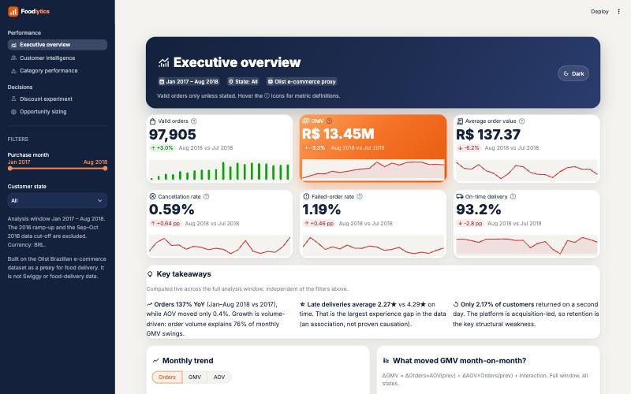
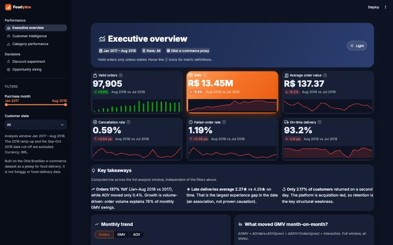
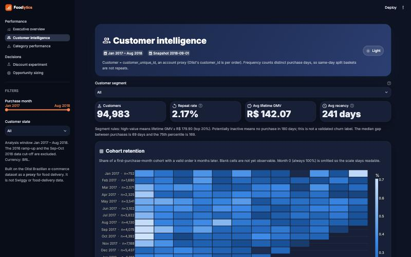
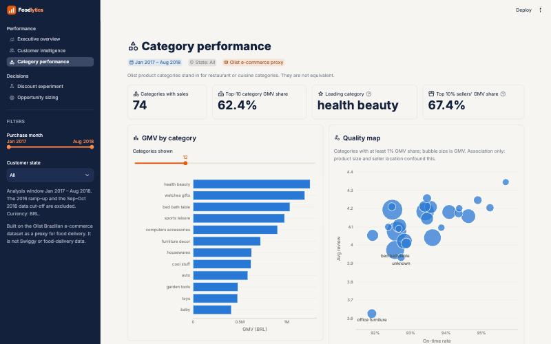
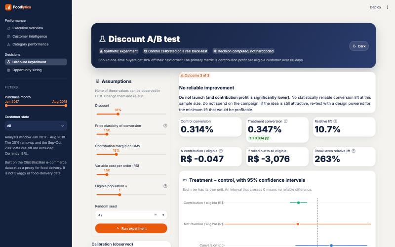
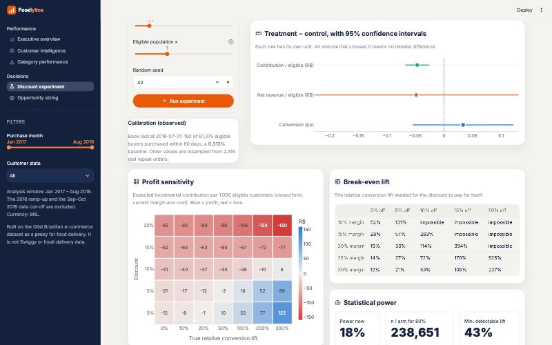

# Foodlytics: Food Delivery Revenue & Growth Intelligence

*Turning transactional data into actionable business decisions.*

Foodlytics is an end-to-end business-analytics project built around the questions a food-delivery business team asks:
- What drives growth?
- Who comes back?
- Where do we lose orders?
- Do discounts create profitable incremental orders?

It covers a reproducible data pipeline, PostgreSQL analytical layer, SQL KPI views, cohort and RFM analysis, a calibrated A/B-test simulator with power and break-even analysis, opportunity sizing, and an interactive Streamlit dashboard.

> **Data disclaimer.** This project uses the public [Olist Brazilian E-Commerce dataset](https://www.kaggle.com/datasets/olistbr/brazilian-ecommerce) (≈100k orders, 2016–2018) as a **proxy**. It is not Swiggy or food-delivery data. Product categories are not cuisines. The **experiment results are synthetic**. Profit figures rely on **stated assumptions**, because Olist has no cost data. Every number in the reports is labelled observed, scenario or simulated.

| Light | Dark |
|---|---|
|  |  |

## Headline findings

| | Finding | Type |
|---|---|---|
| Growth | Orders **+137% YoY** (Jan–Aug 2018 vs 2017) with AOV flat (+0.4%). Volume explains 76% of GMV movement. Monthly orders −10.7% Jan → Aug 2018. | Observed |
| Retention | Only **2.17%** of 94,983 customers buy on a second day. 12-month repeat rate 3.34%. M1 cohort retention 0.48%. | Observed |
| Value concentration | High-value one-time buyers: 19% of customers, **53.5% of GMV**. | Observed |
| Delivery | Late orders average **2.27★ vs 4.29★** on time. 79% of orders more than 8 days late get 1–2★. | Observed (association) |
| Cancellations | 68% happen after approval, before carrier handover (seller-side). Failed-order rate 1.19%. | Observed |
| Discount test | A 10% discount needs a **+263% conversion lift** to break even. Simulated result −R$0.047 contribution per eligible customer (95% CI −0.068 to −0.026). Decision: **do not launch**. | Simulated |
| Opportunity | +1 pp 12-month repeat rate ≈ **R$103k GMV a year**. | Scenario |

Full write-ups: [executive summary](reports/executive_summary.md) · [findings A–C](reports/analysis_findings.md) · [recommendations](reports/business_recommendations.md) · [experiment methodology](reports/experiment_methodology.md) · [metric definitions](reports/metric_definitions.md) · [data dictionary](reports/data_dictionary.md) · [interview prep](interview_prep.md)

## Architecture

```
raw CSVs ──► Python cleaning ──► PostgreSQL ─────────────────────────► Streamlit dashboard
 (ingestion.py) (clean_data.py)   raw.*       verbatim TEXT copies        (dashboard/, live SQL)
                                  clean.*     PK/FK/CHECK + indexes
                                  analytics.* fct_orders, dim_customers,
                                              KPI / cohort / category views,
                                              experiment + sizing tables
                                     │
                                     ├─ validate_data.py      20 data-quality checks
                                     ├─ metrics.py            36 named business queries → reports/results/
                                     ├─ experiment_*.py       back-test calibration → simulation → stats → decision
                                     └─ opportunity_sizing.py scenario model
```

**Design rules**
- Raw, clean and analytics data are kept in separate schemas.
- Items and payments are aggregated to order grain before joining, so nothing is double-counted.
- Anomalies are flagged rather than deleted.
- Every metric is defined once in SQL, and the dashboard, notebooks and reports all read it from there.

## Setup

**Requirements:** Python 3.11+ and PostgreSQL 14+. Tested with Python 3.13 and PostgreSQL 16 on macOS.

```bash
cd foodlytics
python3 -m venv .venv && source .venv/bin/activate
pip install -r requirements.txt
```

PostgreSQL (pick one):

```bash
brew install postgresql@16 && brew services start postgresql@16 && createdb foodlytics
```

```bash
docker run -d --name foodlytics-pg -e POSTGRES_PASSWORD=postgres -e POSTGRES_DB=foodlytics -p 5432:5432 postgres:16
```

Then copy `.env.example` to `.env` and set `PGUSER` / `PGPASSWORD` (the defaults are your OS user with no password on localhost).

### Data

`src/ingestion.py` tries the official Kaggle API first, which needs `pip install kaggle` and `KAGGLE_USERNAME`/`KAGGLE_KEY`. If that fails, it downloads an unmodified public mirror of the same 9 CSVs. Every file's byte size is verified against the Kaggle originals, and a SHA-256 manifest is written.

**Manual alternative:** download the zip from Kaggle and unzip the 9 CSVs into `data/raw/`. Raw data is git-ignored.

### Run everything

```bash
python run_pipeline.py
```

This runs ingest → clean → load → DQ checks → analyses → experiment → sizing, in about 45 seconds.

```bash
python -m pytest -q
```

This runs 57 tests: data quality, KPI recomputation, cohorts, experiment statistics, and dashboard smoke tests.

```bash
python notebooks/build_notebooks.py
```

This regenerates and executes the two notebooks.

```bash
streamlit run dashboard/app.py
```

This opens the dashboard at http://localhost:8501. Run it from the repo root so the theme in `.streamlit/` loads.

## Dashboard

Five pages, all filterable by month range and customer state. A **Light / Dark** button in each page header switches the theme for the whole app. The theme is defined natively in `.streamlit/config.toml`, so Streamlit's own *Settings → Theme* menu stays in sync. KPIs are queried live and never hardcoded. Tooltips carry the metric definitions.

| Page | Contents |
|---|---|
| Executive overview | KPI cards with sparklines and period deltas, computed takeaways, trend, GMV decomposition, cancellations, review vs delivery |
| Customer intelligence | Segment filter, cohort heatmap, new vs returning, segment shares, frequency, purchase gaps, repeat-within-N |
| Category performance | Category ranking, quality map (on-time vs review), monthly trends, scorecard |
| Discount experiment | Assumption sliders that re-run the simulator, computed decision, CIs, profit-sensitivity heatmap, break-even table, power and sample-size calculator |
| Opportunity sizing | Low, base and high scenarios with measurement plans |

| | |
|---|---|
|  |  |
|  |  |

**Power BI:** Power BI Desktop was not available in the build environment (macOS). The `analytics` views are BI-agnostic, so you can connect Power BI to PostgreSQL (`Get Data → PostgreSQL`) and use `v_kpi_monthly`, `v_cohort_retention`, `v_category_performance`, `exp_group_summary` and `opportunity_sizing` directly.

## Repository structure

```
foodlytics/
├── run_pipeline.py              one-command rebuild
├── config/settings.py           paths, DB URL (env vars), analysis parameters
├── sql/
│   ├── schema.sql               clean-layer DDL (PK/FK/CHECK/indexes)
│   ├── analytical_views.sql     analytics layer (single source of metric truth)
│   ├── cleaning_and_validation.sql   20 named DQ checks
│   ├── revenue_analysis.sql     Module A queries
│   ├── customer_retention.sql   Module B queries
│   └── category_analysis.sql    Module C queries
├── src/                         ingestion, cleaning, loading, validation, metrics,
│                                experiment simulator/analysis, opportunity sizing
├── dashboard/                   Streamlit app (app.py + app_pages/ + queries.py + ui.py)
├── notebooks/                   exploratory_analysis.ipynb, experiment_analysis.ipynb (+ builder)
├── tests/                       pytest suite
└── reports/                     markdown reports, results/*.csv, screenshots/
```

## Key assumptions

| Assumption | Value | Where it matters |
|---|---|---|
| Analysis window | Jan 2017 – Aug 2018 | All KPIs. 2016 ramp-up and the Sep–Oct 2018 cut-off are excluded. |
| Customer identity | `customer_unique_id` | Retention. It is an account proxy, not a verified person. |
| Repeat purchase | Distinct purchase days | Same-day split baskets are not repeats. |
| On-time target | Olist's promised delivery date | On-time rate. |
| Contribution margin | 15% of GMV | Experiment and sizing. **Not observable.** |
| Variable cost / order | R$1.50 | Experiment and sizing. **Not observable.** |
| Price elasticity | 1.5 (→ 15% lift at 10% off) | Experiment only. Varied from 0% to 300% lift in the sensitivity analysis. |

## Limitations

- **E-commerce proxy.** Frequencies, baselines and delivery times differ hugely from food delivery. The methods transfer; the levels do not.
- **No cost, marketing, traffic or promotion data.** Profit is scenario-based, and the cause of the 2018 plateau cannot be identified.
- **No churn ground truth.** Segments use rule-based "potentially inactive" labels, not a churn model.
- **Delivery–review and delivery–repeat links are associations.** Causal claims would need experiments, which are proposed in the reports.
- **The experiment is synthetic.** Only the control arm is calibrated on observed data.
- **Recent-month truncation.** Orders near the end of the data can still change status, so late-2018 cancellation rates may be slightly understated or noisy.
